# CMU 11-768 NOTES

## Lec1 What're Agents & How do they work?

### 如何定义一个Agent

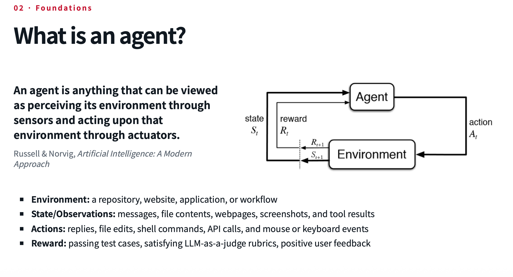

**Environment + State + Actions + Reward**

让我们再 recap 一下LanguageModels：

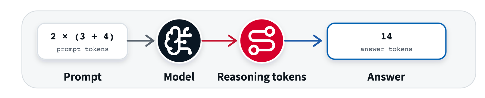

ToolCalling:

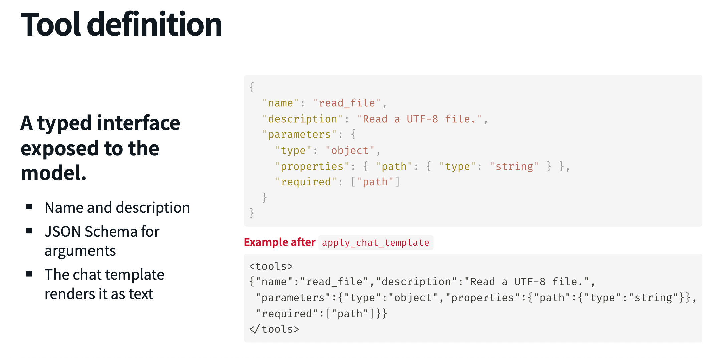

从LLMs 到Agents——

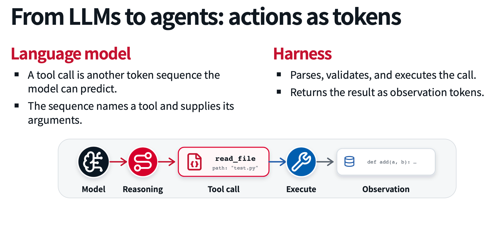

**Model in the loop**

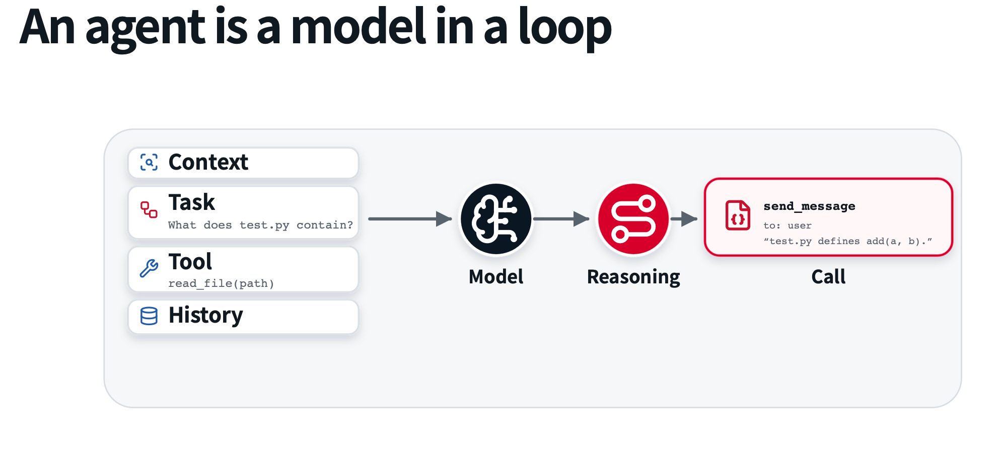

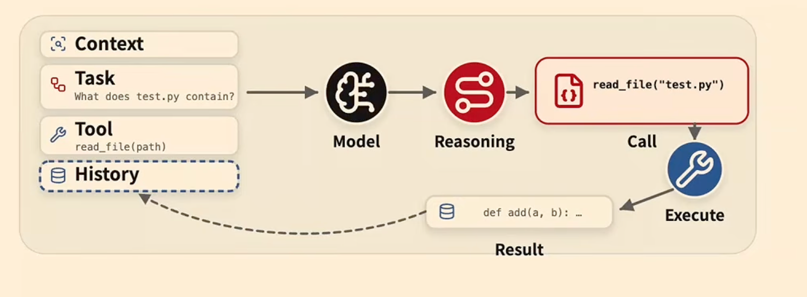

### Agent capabilities

What Makes An Agent Good?

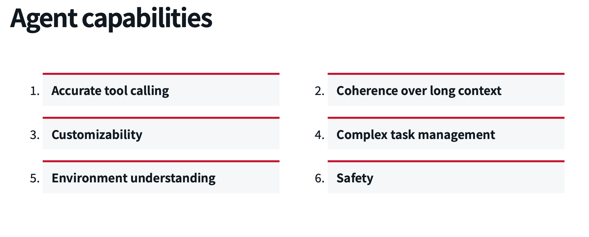

两种方法来 build 出我们想要的 Agents：模型本身的能力或者外层的Harness

**LLMTrainning or HarnessEngineering**

现在很多情况，或者说业界的一个通用点是：很多时候，模型能力的提升也足够完善相当多的Harness。当然，这两者肯定是同样重要的。

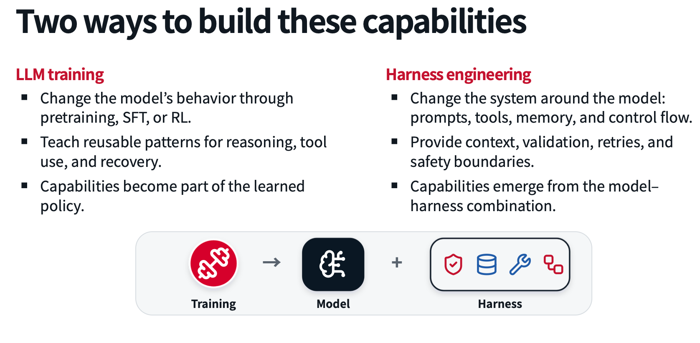

Agents的训练：

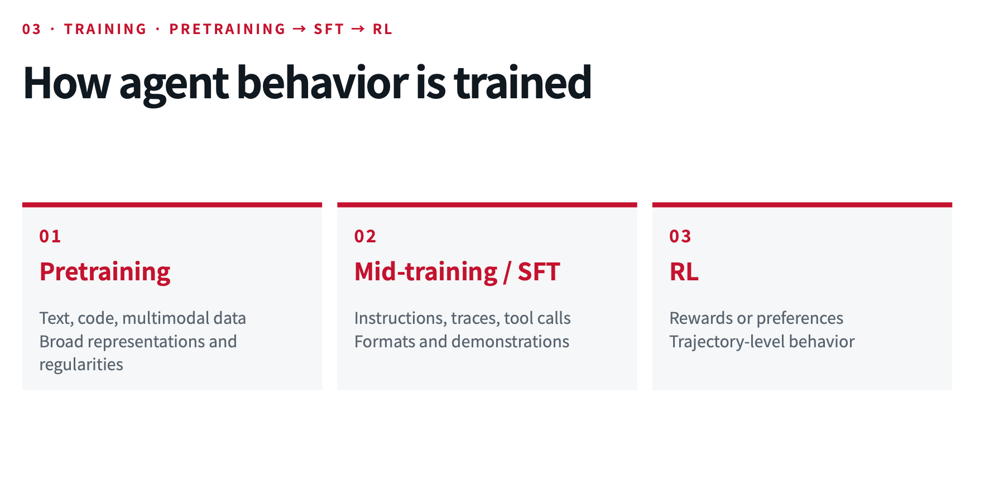

预训练跟我们无关，毕竟现在的模型参数都是 billion 起步，太多啦～
中期训练/监督微调(SFT) & 强化学习(RL) 会是我们比较关注的点。

#### 六个Agents能力进行拆解

**（1）准确的工具调用**

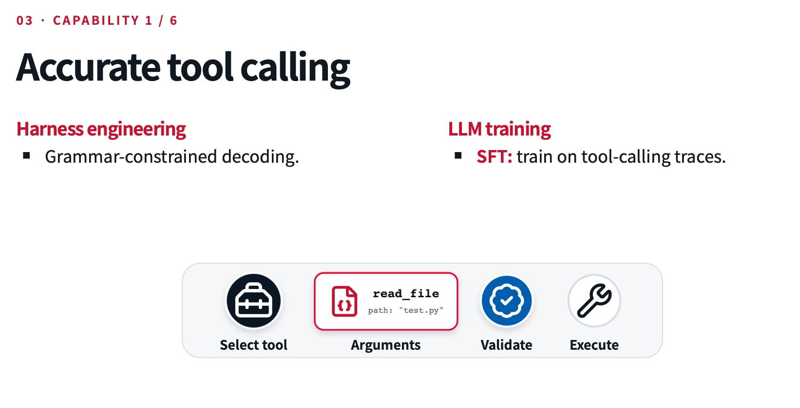

**（2）长上下文的连贯性**

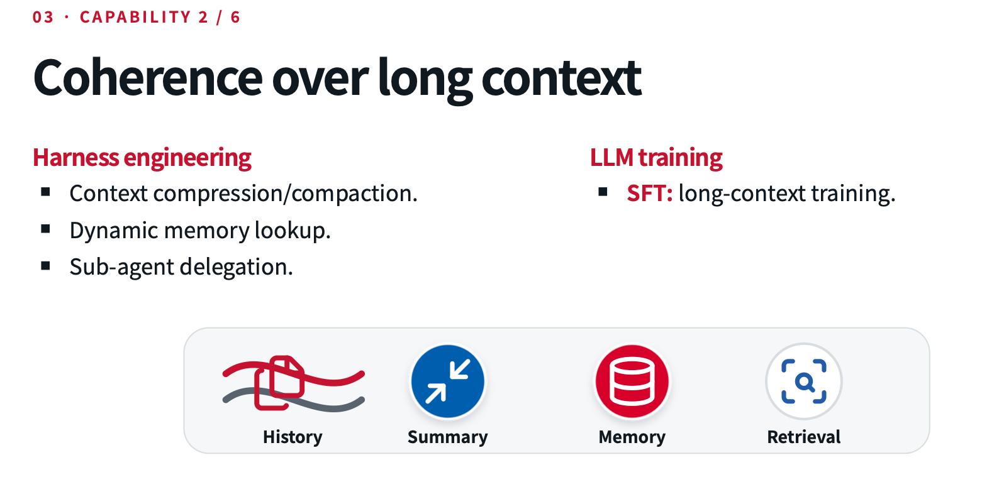

**（3）定制性**

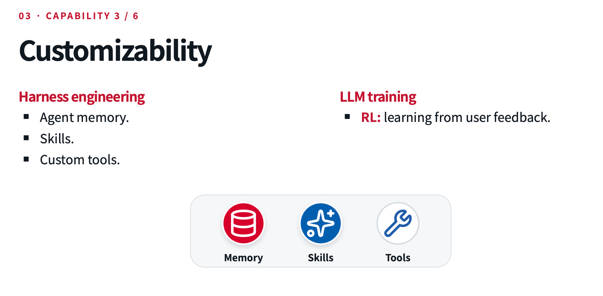

**（4）复杂任务管理**

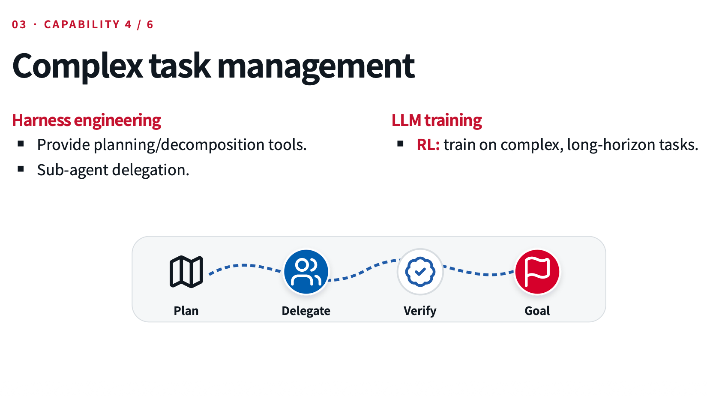

**（5）环境理解**

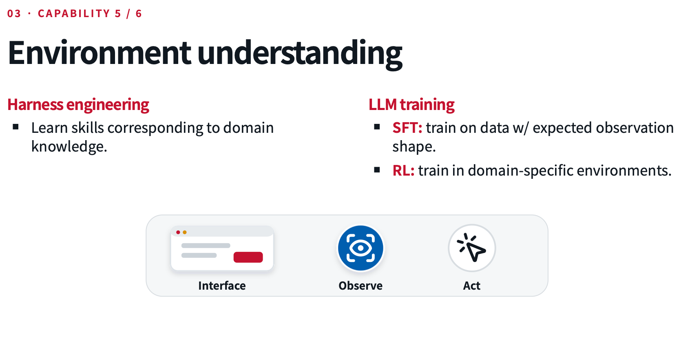

**（6）安全性**

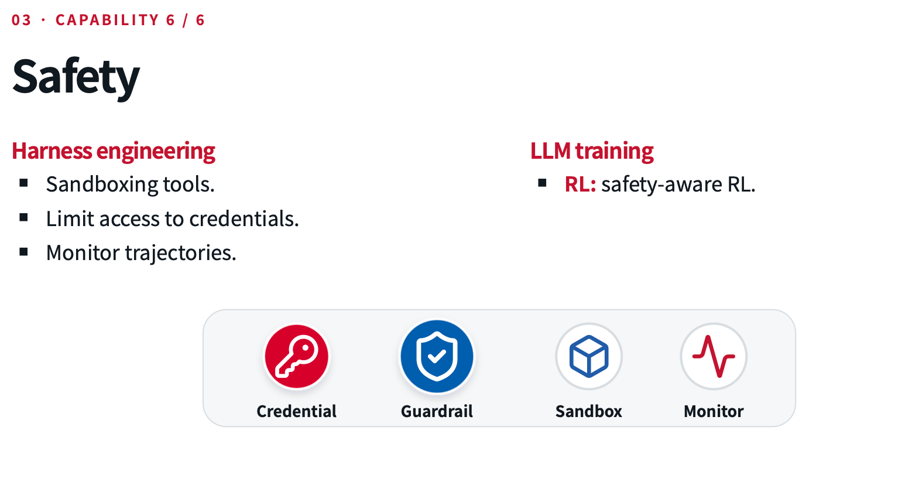

### AgentEngineering

Agents是系统，而不只是模型

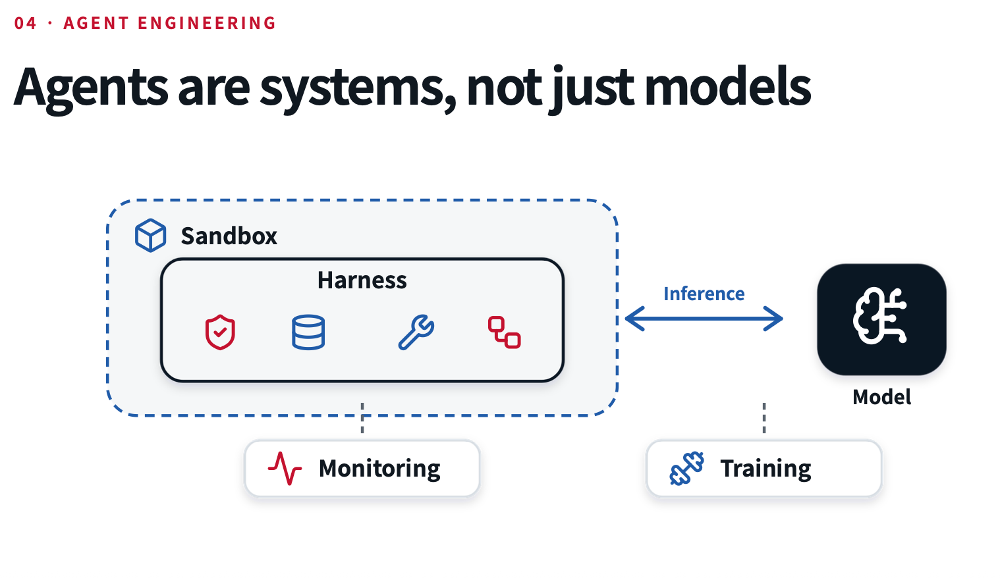

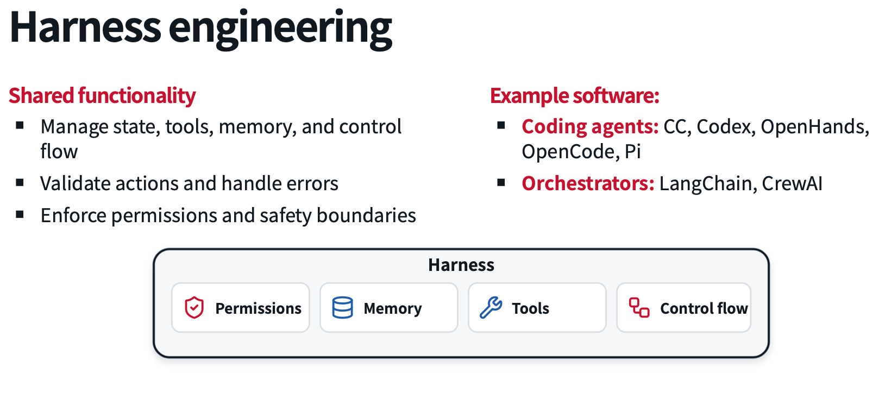

诸如 LangChain 这样的Orchestrators现在已经不怎么提了，复杂度较低，只能查查数据，而写不出真实的程序。

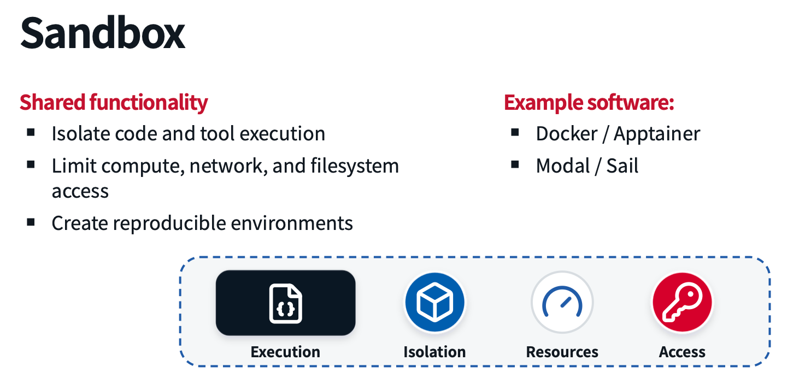

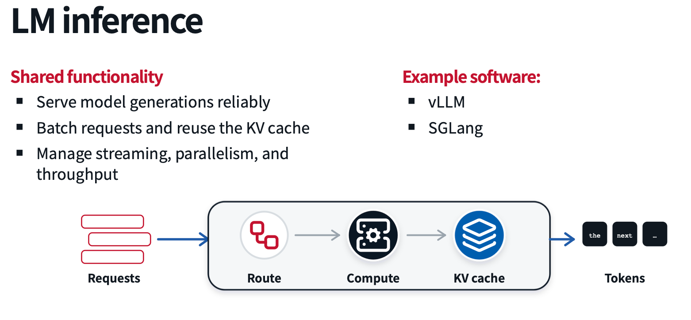

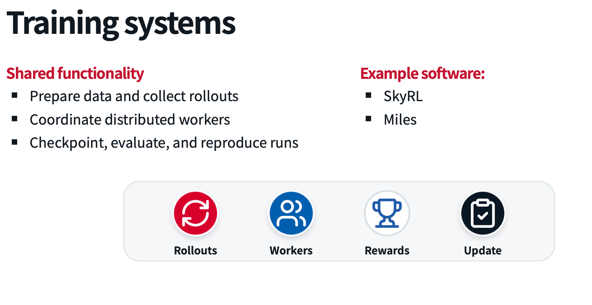

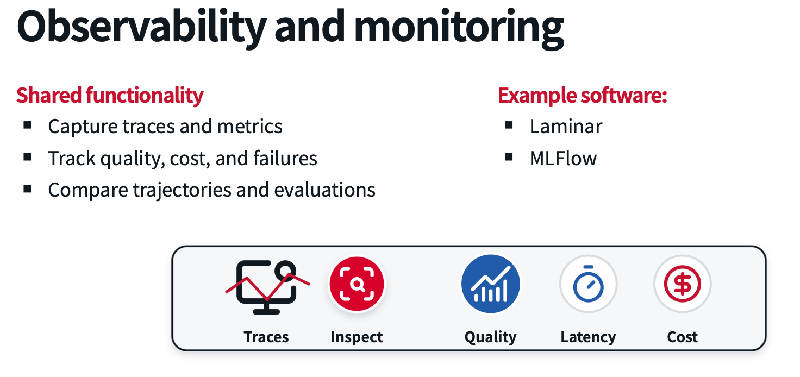

